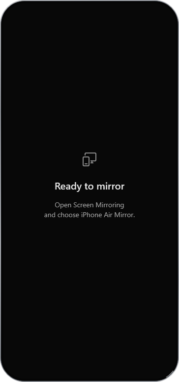
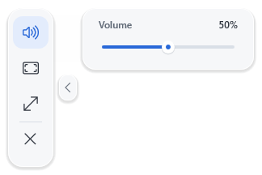

# iPhone Air Mirror

Mirror your iPhone's screen and sound on Windows over your local network.
No cable, account or extra iPhone app needed.

  
  

## Install

Download the [installer](https://github.com/yungtristxn/iPhoneAirMirror/releases/download/v0.1.0-beta.1/iPhoneAirMirror-0.1.0-beta.1-windows-x64-setup.exe)
or [portable ZIP](https://github.com/yungtristxn/iPhoneAirMirror/releases/download/v0.1.0-beta.1/iPhoneAirMirror-0.1.0-beta.1-windows-x64-portable.zip).
For the portable version, extract the ZIP and run `Start-iPhoneAirMirror.cmd`.

Requires 64-bit Windows 10 (1703+) or Windows 11, a compatible GPU and an audio
output. If needed, install Microsoft's [Visual C++ x64 runtime](https://aka.ms/vc14/vc_redist.x64.exe).
Windows N also needs the [Media Feature Pack](https://support.microsoft.com/en-us/windows/experience/platform-variants/media-feature-pack-for-windows-n).

## Use

1. Open iPhone Air Mirror and connect both devices to the same network.
2. On your iPhone, open **Control Center → Screen Mirroring → iPhone Air Mirror**.
3. Drag the window to move it or its bottom-right corner to resize it. The side
   controls handle volume, fullscreen and resetting the size. Close the window to quit.

This is an unsigned beta. See the [release notes](https://github.com/yungtristxn/iPhoneAirMirror/releases/tag/v0.1.0-beta.1)
for known limitations.

[GPL-3.0](LICENSE.md) · [Build and development](docs/VALIDATION.md)
· Independent project, not affiliated with Apple.
